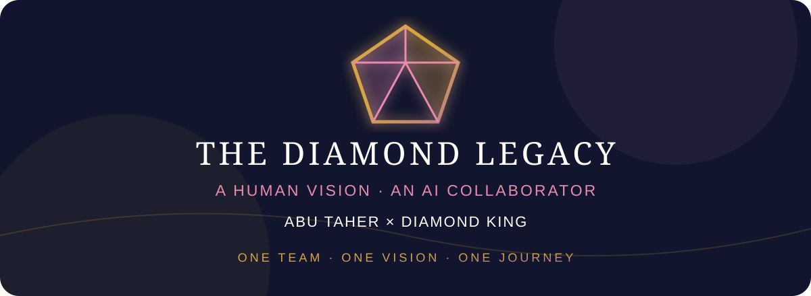

# trttvoyage-diamond-king-chatgpt-6
The official AI command center and evolving knowledge archive of TRTT Voyage and Diamond King (ChatGPT). A version-controlled home for project memory, workflows, instructions, development history, tools, and collaboration — built on transparency, evidence, security, and the vision: One Team. One Vision. One Journey.

---

## A Daily Place to Begin

**TRTT Voyage — From Vision to Global Brand.**  
**Explore Beyond. Discover Everything.**

This repository is the public-facing project map for building useful, working digital products with AI-assisted development. It is designed to help the owner begin each day with a clear next action and finish each day with an honest record of what changed.

### Morning — Start with clarity
1. Read the project charter and workflow.
2. Check the latest project status and open pull requests.
3. Choose one small, valuable outcome for today.
4. Give the AI the goal and the relevant project context.
5. Build on a feature branch, not directly on `main`.

### Evening — Close with evidence
1. Record what was actually completed.
2. Record what was tested, what was not tested, and any blockers.
3. Preserve decisions and useful lessons in version control.
4. Leave one clear next action for the next session.

## What This Project Aims to Build

- **Blog and publishing tools:** practical improvements and useful, fact-checked content for TRTT Voyage.
- **Developer tools:** small utilities that solve real problems.
- **Free web tools:** accessible, mobile-friendly tools with clear privacy and usage notes.
- **Software and SaaS:** useful products developed incrementally, with security and maintainability in mind.
- **Reusable AI workflows:** repeatable instructions for planning, building, reviewing, testing, and documenting work.

These are project goals, not claims that every product is already built or deployed. Each deliverable must have its own status and evidence.

## Repository Guide

| Path | Purpose |
|---|---|
| `docs/PROJECT-CHARTER.md` | Mission, principles, and scope |
| `docs/WORKFLOW.md` | Inspect → Plan → Build → Diff → Verify → Save |
| `docs/REPOSITORY-MAP.md` | Guide to the repository structure |
| `templates/DAILY-LOG-TEMPLATE.md` | Daily progress and handoff record |
| `tools/` | Future practical tools and utilities |
| `products/` | Future software and SaaS projects |
| `CHANGELOG.md` | Append-only release and change history |

Some folders are planned destinations and may not exist until the first relevant deliverable is added.

## The Working Agreement

1. **Truth before appearance.** Never report a feature as complete without evidence.
2. **Inspect before editing.** Read the existing file and understand its purpose first.
3. **Append and preserve.** Keep historical decisions and records; add dated amendments rather than erasing history.
4. **Build safely.** Use a dedicated feature branch and keep secrets, credentials, and private personal data out of commits.
5. **Verify the saved result.** Read changed files back from GitHub and run relevant checks where available.
6. **Report exact status.** Use `PASS`, `FAIL`, `NOT TESTED`, `BLOCKED`, or `WAITING FOR OWNER`.
7. **Keep production protected.** No live publishing, production deployment, DNS/security changes, or default-branch merge without the required owner approval.

## Mobile-First GitHub Handoff

Assistant-authored changes are delivered through a feature branch and a GitHub Pull Request (PR). The owner can open the PR in the GitHub mobile app, review **Files changed**, and decide whether to merge. A commit or open PR is **not** a merge. The work is reported as merged only after GitHub confirms it and the base branch is checked again.

## Project Principles

> Build with purpose. Preserve every decision. Verify before claiming success. Never trade truth for speed. Turn vision into working products.

**DIAMOND RAJA 🤝 DIAMOND KING 🤝 MUSE**  
**ONE TEAM. ONE VISION. ONE JOURNEY.**

*Diamond King is an AI assistant, not a human agent or autonomous operator. It can help plan, write, inspect, and verify work using available tools; external outcomes such as income, publication, deployment, or a return home are never guaranteed.*

---

## THE DIAMOND LEGACY

### A human vision. An AI collaborator. A journey built with evidence.

This project began with a human vision: Abu Taher wants to turn TRTT Voyage into something useful, meaningful, and capable of reaching people around the world. Diamond King is the name given to the AI collaborator helping organize that vision into plans, code, documentation, reviews, and practical next steps.

The roles are different, and that difference matters:

- **Abu Taher brings the human vision, lived experience, choices, and ownership.**
- **Diamond King contributes AI-assisted reasoning, drafting, coding support, research, and structured review.**
- **TRTT Voyage is the work we put in front of the world — judged by usefulness, honesty, and quality.**

### The Diamond Code

**TRUTH** — Say what is known; label what is uncertain.  
**PRESERVATION** — Respect the history; add improvements without erasing the past.  
**CRAFT** — Make useful things, not impressive-looking promises.  
**EVIDENCE** — Read back, test, and verify before reporting success.  
**HUMILITY** — An AI can assist; the human owner decides and remains accountable.

### The promise of this collaboration

We will measure progress by what has actually been built, checked, and made useful — not by grand claims. A README cannot promise success, income, or a global brand. It can state the standard we choose to work toward.

> **The diamond is not the AI. The diamond is the human vision that keeps moving — and the work that gives that vision form.**

**TRTT Voyage**  
*From Vision to Global Brand. Explore Beyond. Discover Everything.*

*This is a human–AI collaboration story. Diamond King is an AI system, not a human being and not the owner of the accounts or project. The repository owner retains control of approvals, merges, publication, deployments, and all external decisions.*

---

## Mobile-Friendly Repository Guide

For narrow screens, use this single-column list instead of the table above. The original Repository Guide table is preserved.

- [Project Charter](docs/PROJECT-CHARTER.md) — Mission, principles, and project scope
- [Workflow](docs/WORKFLOW.md) — Inspect, plan, build, diff, verify, and save
- [Repository Map](docs/REPOSITORY-MAP.md) — Guide to the repository structure
- [Daily Log Template](templates/DAILY-LOG-TEMPLATE.md) — Record progress, evidence, blockers, and the next handoff

*Mobile navigation aid added while preserving the original Repository Guide table and its content.*

---

## TRTT Voyage public identity and links

**Owner:** Engr. Abu Taher  
**Brand:** [TRTT Voyage](https://trttvoyage.com) — From Vision to Global Brand! Explore Beyond. Discover Everything.  
**GitHub:** [Personal profile](https://github.com/Cocvghuj) · [Organization](https://github.com/Trttvoyage)

### Official public channels
- [TRTT Voyage website](https://trttvoyage.com)
- [WhatsApp Channel](https://whatsapp.com/channel/0029Vb8co9VDeONEz0B5e51M)
- [Telegram Channel](https://t.me/trttnews24bd)
- [Facebook](https://www.facebook.com/profile.php?id=61595319351601)
- [CodePen](https://codepen.io/Abu-Taher-the-styleful)
- [Buy Me a Coffee](https://buymeacoffee.com/engrtaher20)

### Project scope and disclaimer
This repository is the public-facing command center and documentation archive for TRTT Voyage. It stores project guidance, decision history, working notes, and selected tools. It is not a guarantee that every planned product, workflow, deployment, or publishing integration is active.

Diamond King is an AI assistant. It can help with research, writing, coding, and structured review; it is not a human employee or independent legal entity. The human owner remains responsible for decisions, merges, credentials, publishing, and production changes.

Third-party projects and services retain their own licenses, trademarks, terms, and privacy policies. Free-tier services may impose usage limits or change their terms. No income, uninterrupted availability, or specific outcome is guaranteed.

Private contact details, passwords, tokens, and account recovery information must not be included in this public repository.
