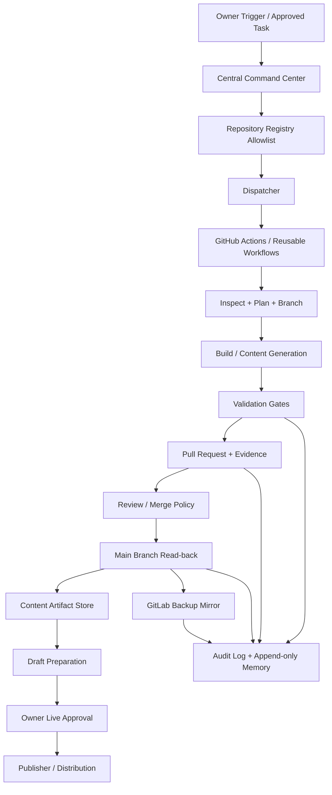

# Automated GitOps & AI-Driven Workflow
## Headless AI-Powered Content Pipeline

**Project:** DR-TRTT-OPS-001 · TRTT Voyage  
**Status:** Architecture blueprint — implementation not yet enabled  
**Source of truth:** GitHub  
**Operating principle:** One control plane, explicit repository allowlists, pull-request-only writes, verifiable backups.

## 1. Objective

Build a central automation system that can coordinate approved work across multiple TRTT repositories without manually repeating the same operation in each repository.

The system has two connected capabilities:

1. **Automated GitOps:** inspect repositories, route work, create feature branches, run checks, open pull requests, record evidence, and verify backups.
2. **Headless AI-Powered Content Pipeline:** collect approved source material, generate English content, validate claims and originality, create reviewable content artifacts, and prepare downstream drafts only after the required gates.

“Headless” means the pipeline can run through APIs and workflow events without a person manually operating every repository page. It does not mean removing human approval from risky or public actions.

## 2. High-level architecture

The diagram is a target design, not proof that these integrations currently exist.

## 3. Core components

| Component | Responsibility | Initial implementation choice |
|---|---|---|
| Command Center | Task intake, policies, memory, portfolio status | This GitHub repository |
| Repository Registry | Explicit allowlist and per-repo capabilities | Versioned JSON file |
| Dispatcher | Route one task to selected repositories | GitHub Actions workflow dispatch |
| Worker workflows | Run repository-specific tasks | Reusable GitHub Actions workflows |
| AI provider gateway | Generate structured drafts from approved inputs | OpenRouter free-only route, when configured |
| Validation layer | Fact, source, duplication, policy and schema checks | Deterministic scripts plus review |
| GitOps layer | Branch, commit, PR, checks and read-back | GitHub API / Actions |
| Backup layer | Mirror verified Git history and artifacts | GitLab, after access and restore test |
| Content pipeline | Source → draft → review → draft destination → live approval | Versioned content artifacts |
| Audit trail | Record triggers, decisions, SHAs, run IDs and outcomes | Append-only memory + workflow artifacts |

Make.com may be used as an optional event orchestrator if the Owner chooses it and its plan limits/costs are acceptable. It is not a dependency of this design. A free-first GitHub Actions dispatcher can serve as the initial orchestrator.

## 4. Repository enrollment and allowlist

Never run a workflow against every repository returned by an account search. The registry is the authority for enrollment.

Each repository entry must define:
- Exact `owner/repository` identity.
- Whether it is enrolled.
- Its default branch.
- Repository class: product, website, content, profile, template, learning import, fork, archive or experiment.
- Permitted task types.
- Backup destination and last verified backup SHA.
- Required checks and risk tier.
- Whether AI content generation is allowed.
- Whether publishing integrations are allowed (disabled by default).

The initial registry intentionally enables only the Command Center and Abu Taher Profile Hub as **pilot candidates**. Runtime automation remains disabled until workflow implementation, access configuration and test evidence are complete.

## 5. Safe GitOps transaction

Every repository write follows this transaction:

1. Resolve repository from the allowlist; reject unknown repositories.
2. Read repository metadata, default branch, latest SHA, open PRs and relevant files.
3. Check for duplicate work and uncommitted/open changes.
4. Create a uniquely named feature branch from the inspected base SHA.
5. Apply only the scoped change; never delete files as a cleanup shortcut.
6. Run available tests, lint, security checks and content validation.
7. Generate a PR with purpose, scope, changed paths, evidence, risks and rollback notes.
8. Re-fetch the PR and confirm the head SHA has not changed.
9. Merge only if the task is low-risk, checks pass (or no required checks exist and the change is demonstrably low-risk), and merge authority applies.
10. Read back the merged files from the default branch and record the merge SHA.
11. Mirror to backup only after the source commit is verified.
12. Verify the backup commit and periodically perform a restore test.

**No direct writes to the default branch.** A failed or ambiguous step stops the transaction; it must not be silently retried with a broader scope.

## 6. Non-destructive safety policy

The pipeline must enforce these invariants:

- No automatic repository deletion, file deletion, force push, branch rewrite or destructive synchronization.
- No blind overwrite. Existing files must be read and diffed; changes go through PR review.
- No secrets in repository files, prompts, logs, artifacts or memory. Use named GitHub Actions secrets only after an authorized operator configures them.
- No cross-repository fan-out until the target list and task scope are resolved from the allowlist.
- No propagation of a failed or unverified change to other repositories.
- No live Blogger publishing, Telegram posting, production deployment, DNS, billing, legal or account-security changes without the required explicit Owner approval.
- Backup systems must preserve history and be tested by restoring to an isolated location.
- Idempotency keys and run IDs must prevent duplicate commits, posts and notifications.
- Each worker must use least-privilege permissions scoped to the target repository and task.

A backup is not a substitute for safe writes. A mirror that reproduces accidental deletion is not a reliable recovery strategy; protected snapshots and restore tests are required.

## 7. Headless AI content pipeline

```mermaid
flowchart LR
    A[Approved source inputs] --> B[Source capture + provenance]
    B --> C[AI structured draft]
    C --> D[Fact and date verification]
    D --> E[Originality + duplicate check]
    E --> F[Editorial and policy validation]
    F --> G[English HTML / Markdown artifact]
    G --> H[GitHub PR for review]
    H --> I[Approved content record]
    I --> J[Blogger draft preparation]
    J --> K[Owner live approval]
    K --> L[Telegram distribution]
```

### Content gates

- Source URL, publisher, publication date and retrieval date are recorded.
- Time-sensitive claims are rechecked before a draft is prepared.
- Every factual claim is traceable to a source; uncertain claims are removed or clearly qualified.
- AI output is treated as an unverified draft, never as a source.
- Duplicate-title and duplicate-content checks run before a PR is opened.
- TRTT public content is English and includes the appropriate TRTT Voyage identity and site link.
- Article images must have usage rights and be embedded in the article HTML where required.
- Blogger output remains a draft until explicitly authorized for live publication.
- Telegram distribution occurs only after a confirmed live URL and explicit distribution authorization.

## 8. Failure handling and recovery

| Failure | Required behaviour |
|---|---|
| Repository not in registry | Reject; do not infer enrollment |
| Base branch changed during task | Stop and re-inspect |
| Tests fail | Keep PR unmerged; record failure |
| PR head changes | Re-fetch and revalidate |
| Backup unavailable | Preserve verified GitHub source; mark backup NOT VERIFIED |
| AI provider unavailable | Stop generation; do not use paid fallback |
| Source cannot be verified | Do not publish or present the claim as fact |
| Duplicate content detected | Stop and link the existing artifact |
| Partial fan-out failure | Record per-repo outcomes; do not claim global success |
| Restore test fails | Suspend backup-success claims and repair recovery path |

Retries must be bounded and idempotent. Never retry a destructive action automatically.

## 9. Observability and audit record

Every run should record:
- UTC timestamp and project code.
- Trigger ID and idempotency key.
- Repository and branch.
- Base SHA and resulting commit SHA.
- Workflow run ID and test results.
- PR URL and PR head SHA.
- Merge SHA, if merged.
- Backup destination and verified backup SHA.
- Content source references and validation result.
- Status: PASS, FAIL, NOT TESTED or NOT VERIFIED.
- Next action and any required Owner approval.

Do not store tokens, passwords, private keys, personal data or raw provider credentials in this record.

## 10. Phased rollout

| Phase | Deliverable | Exit gate |
|---|---|---|
| 0 — Blueprint | Architecture, safety policy and registry | Docs read back and reviewed |
| 1 — Pilot registry | Two repositories explicitly enrolled | Repo identity and permissions verified |
| 2 — GitHub dispatcher | Manual dispatch, dry-run and allowlist validation | No-write dry-run passes |
| 3 — PR worker | Feature branch, checks and PR creation | Test PR succeeds; no default-branch writes |
| 4 — Backup worker | GitLab mirror and recovery procedure | Commit SHA matches and isolated restore succeeds |
| 5 — AI content worker | Source-grounded draft generation and validators | Test content passes all gates |
| 6 — Publishing handoff | Blogger draft and Telegram approval gates | Draft state and live approval independently verified |
| 7 — Controlled expansion | Add repositories in reviewed batches | Per-repo evidence and rollback plan |

No phase is considered complete merely because its documentation exists.

## 11. Initial pilot boundaries

Pilot candidates:
- `TRTT-VOYAGE/trttvoyage-diamond-king-chatgpt-6` — central policies, registry, memory and orchestration documentation.
- `TRTT-VOYAGE/abu-taher` — profile hub and documentation-oriented test target.

Initial permitted actions: read-only inspection, dry-run planning, feature-branch changes, PR creation, validation and read-back.

Initially prohibited: bulk fan-out, delete/rename/mass overwrite, GitLab writes, Blogger account actions, Telegram sends, production deploys and security/account setting changes.

## 12. Implementation status

- Architecture blueprint: being proposed in this change.
- Pilot registry: configuration file created with runtime automation disabled.
- Make.com account/scenario: not connected or configured.
- GitHub Actions dispatcher/worker: not implemented by this documentation change.
- OpenRouter secret and free route: not configured or tested.
- GitLab backup and restore: not configured or tested in this stage.
- Blogger and Telegram: not configured or tested in this stage.

**Truth rule:** A documented design is a blueprint. Only a successful run with inspectable evidence can be reported as implemented or verified.
